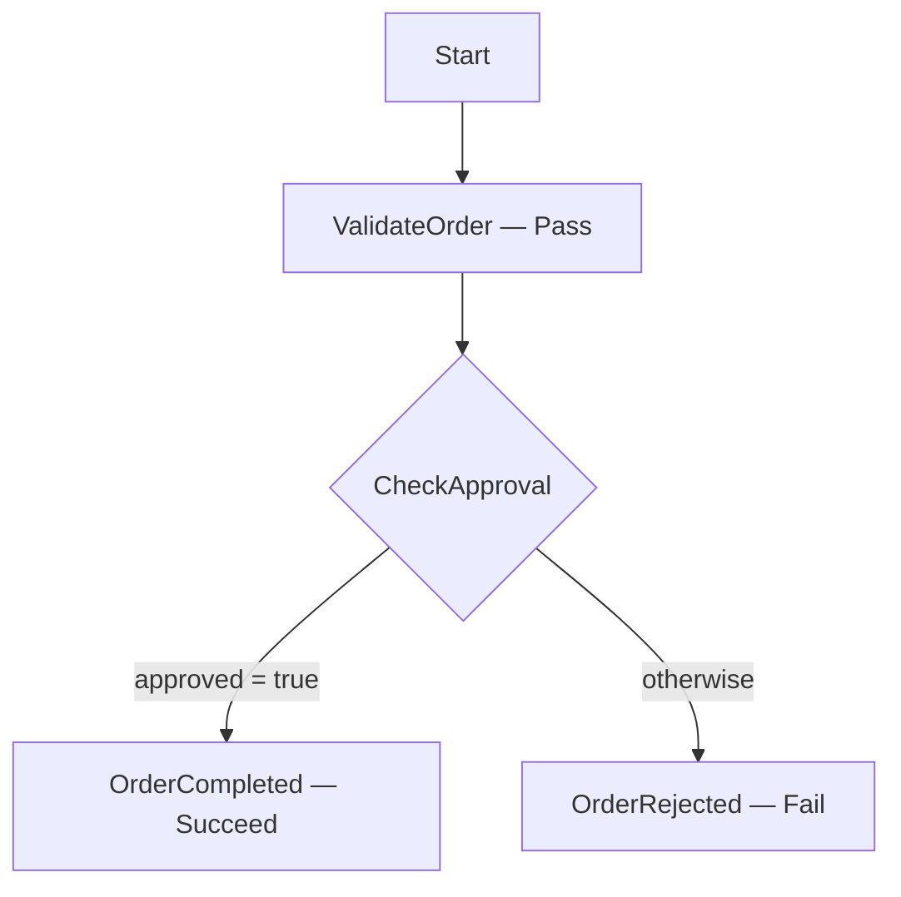
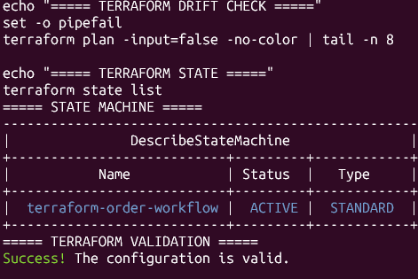

# AWS Step Functions Terraform Lab

## Project Overview

This project demonstrates provisioning an AWS Step Functions
STANDARD state machine using Terraform and AWS CLI.

**Deployment status: DEPLOYED AND VERIFIED**

AWS Region: us-east-1

## Architecture



The workflow evaluates the `approved` field in its input.

The ValidateOrder Pass state forwards the input unchanged;
it does not perform business validation.

## Deployed AWS Resources

| Resource | Count | Status |
|---|---:|---|
| IAM execution role | 1 | Deployed |
| Step Functions STANDARD state machine | 1 | Deployed |
| **Total AWS resources** | **2** | **Verified** |

Terraform also uses one IAM policy document data source.

## Technical Configuration

- State machine: terraform-order-workflow
- Type: STANDARD
- Status: ACTIVE
- IAM role: terraform-stepfunctions-lab-role
- Workflow definition: order-workflow.asl.json
- Region: us-east-1

## Workflow Logic

The workflow contains:

1. ValidateOrder — Pass state
2. CheckApproval — Choice state
3. OrderCompleted — Succeed state
4. OrderRejected — Fail state

Example approved input:

```json
{
  "orderId": "ORDER-1001",
  "approved": true
}
```

Example rejected input:

```json
{
  "orderId": "ORDER-1002",
  "approved": false
}
```

These are examples. Workflow executions have not yet
been tested as part of this lab.

## Deployment Verification

Executed commands:

```bash
terraform validate
terraform state list
terraform plan -input=false -no-color
aws stepfunctions describe-state-machine
```

Verified results:

- State machine status: ACTIVE
- State machine type: STANDARD
- Terraform validation: Passed
- Terraform drift: No changes
- Terraform-managed AWS resources: 2

See [Validation Evidence](docs/validation-evidence.md).

## Security

- IAM role trusts the Step Functions service.
- No additional AWS service permissions are attached.
- Do not commit Terraform state or credentials.
- Use least-privilege IAM permissions.

## Costs

AWS Step Functions STANDARD workflow executions
can incur charges.

Monitor usage and remove unused resources when appropriate.

## Current Limitations

- No workflow executions have been tested.
- No Lambda or SQS integration is configured.
- No production monitoring or alerting is configured.
- No business validation occurs in the Pass state.

## Future Improvements

- Test approved and rejected workflow executions.
- Add input validation.
- Integrate Lambda or SQS.
- Configure CloudWatch logging.
- Add monitoring and alerting.

## Actual Validation Screenshot


