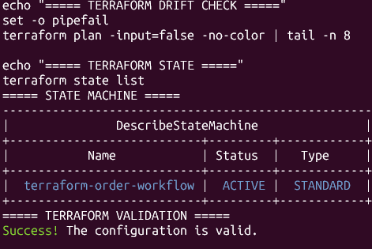

# AWS Step Functions Validation Evidence

## Deployment Status

DEPLOYED AND VERIFIED

## Environment

- Ubuntu Linux (WSL2)
- AWS Region: us-east-1
- Terraform version: 1.17.0
- AWS CLI

## Deployed Resources

1. aws_iam_role.stepfunctions
2. aws_sfn_state_machine.order_workflow

Terraform data source:

data.aws_iam_policy_document.stepfunctions_trust

## AWS CLI Verification

State machine name:

terraform-order-workflow

State machine type:

STANDARD

State machine status:

ACTIVE

IAM execution role:

terraform-stepfunctions-lab-role

## Terraform Validation

Command:

terraform validate

Result:

Success! The configuration is valid.

## Terraform Drift Check

Command:

terraform plan -input=false -no-color

Result:

No changes. Your infrastructure matches the configuration.

## Terraform State

Verified:

- data.aws_iam_policy_document.stepfunctions_trust
- aws_iam_role.stepfunctions
- aws_sfn_state_machine.order_workflow

## Limitations

- No workflow execution tested yet
- No Lambda integration
- No SQS integration
- No production monitoring configured

## Screenshot

